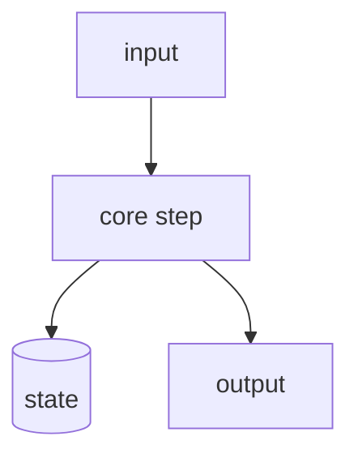

# {{PROJECT}} — {{ONE_LINE}}

[فارسی](README.fa.md) · **English**

<!-- What it is, who it is for, why it exists. Two to four sentences.
     No adjective that cannot be checked. If the status is unknown, say so. -->

## At a glance

| | |
|---|---|
| What | … |
| Runs on | … (runtime, host, ports) |
| Status | version `0.1.0`, last verified `<date>` |
| Owner / visibility | … / public or private |

## How it fits together



<!-- Replace with the real four to eight boxes. A diagram that lies is worse than none. -->

## Repository map

| path | role |
|---|---|
| `src/` | … |
| `docs/` | … |
| `scripts/` | … |

## Run it

```bash
# commands that work on a fresh clone, in order, with the expected output
```

## Verify it

```bash
# one command per claim made above; a test, a check, a measured number
```

## Decisions that are easy to get wrong

- **Rule.** Why it exists and what breaks when it is ignored. One per line, three to five lines.

## Status and next

Current state: `HANDOFF.md`. Open work: `docs/OPEN-ITEMS.md`. Why it is built this way:
`docs/ARCHITECTURE.md` (only when the question needs it).

## Where to start reading

1. `AGENTS.md` — file map and hard rules
2. `HANDOFF.md` — where the work stopped
3. `docs/OPEN-ITEMS.md` — what is next, cheapest first
