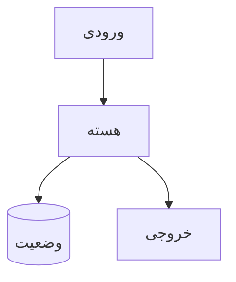

# {{PROJECT}} — {{ONE_LINE}}

**فارسی** · [English](README.md)

<!-- چیست، برای کیست، چرا وجود دارد. دو تا چهار جمله.
     هیچ صفتی که قابل بررسی نباشد. اگر وضعیتی معلوم نیست، همان را بنویس. -->

## در یک نگاه

| | |
|---|---|
| چیست | … |
| کجا اجرا می‌شود | … (زمان اجرا، میزبان، پورت) |
| وضعیت | نسخهٔ `0.1.0`، آخرین بررسی `<تاریخ>` |
| مالک / دسترسی | … / عمومی یا خصوصی |

## چطور سرهم می‌شود



<!-- با چهار تا هشت جعبهٔ واقعی عوضش کن. نموداری که دروغ بگوید از نبودنش بدتر است. -->

## نقشهٔ مخزن

| مسیر | نقش |
|---|---|
| `src/` | … |
| `docs/` | … |
| `scripts/` | … |

## اجرا

```bash
# دستورهایی که روی کلون تازه کار می‌کنند، به ترتیب، با خروجی موردانتظار
```

## بررسی

```bash
# برای هر ادعای بالا یک دستور: تست، گیت، عدد اندازه‌گیری‌شده
```

## تصمیم‌هایی که راحت اشتباه می‌شوند

- **قاعده.** چرا وجود دارد و نقضش چه چیزی را می‌شکند. هر خط یکی، سه تا پنج خط.

## وضعیت و بعد

وضعیت فعلی: `HANDOFF.md`. کارهای باز: `docs/OPEN-ITEMS.md`. چرا این‌طور ساخته شده:
`docs/ARCHITECTURE.md` (فقط وقتی سؤال به آن نیاز دارد).

## از کجا شروع به خواندن کن

۱. `AGENTS.md` — نقشهٔ فایل‌ها و قاعده‌های سخت
۲. `HANDOFF.md` — کار کجا متوقف شده
۳. `docs/OPEN-ITEMS.md` — قدم بعدی، از ارزان به گران
